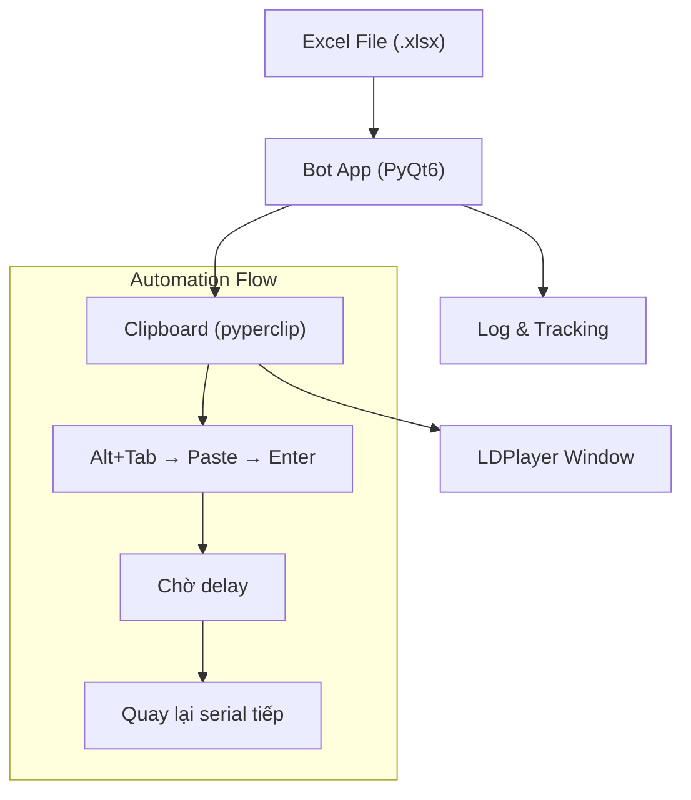

# Bot Kiểm Đếm Serial - LDPlayer Automation

Bot desktop tự động đọc serial từ file Excel, lần lượt paste vào app trên giả lập LDPlayer, theo dõi tiến trình và ghi log kết quả.

## Tổng Quan Kiến Trúc



## Tech Stack

| Thành phần | Công nghệ | Mục đích |
|---|---|---|
| GUI | **PyQt6** | Giao diện desktop đẹp, modern |
| Excel | **openpyxl** | Đọc file .xlsx |
| Automation | **pyautogui** + **pyperclip** | Điều khiển bàn phím, clipboard |
| Window Control | **pygetwindow** (hoặc win32gui) | Tìm/focus cửa sổ LDPlayer |

## Proposed Changes

### [NEW] Cấu trúc dự án

```
bot auto/
├── main.py              # Entry point
├── bot_gui.py           # Giao diện PyQt6
├── bot_worker.py        # Logic automation chạy trong QThread
├── excel_reader.py      # Đọc file Excel
├── requirements.txt     # Dependencies
└── README.md            # Hướng dẫn sử dụng
```

---

### [NEW] [main.py](file:///c:/Users/Admin/Desktop/bot%20auto/main.py)
- Entry point khởi chạy ứng dụng PyQt6

---

### [NEW] [bot_gui.py](file:///c:/Users/Admin/Desktop/bot%20auto/bot_gui.py)
Giao diện chính với thiết kế dark-mode premium:

**Khu vực cấu hình:**
- Chọn file Excel (file browser dialog)
- Nhập tên sheet (text input, mặc định lấy sheet đầu tiên)
- Nhập cột serial (text input, mặc định "H")
- Nhập hàng bắt đầu (spinbox, mặc định 2)
- Delay giữa mỗi serial (spinbox, 1-30 giây, mặc định 3)

**Khu vực điều khiển:**
- Nút **Start** - bắt đầu chạy bot
- Nút **Pause/Resume** - tạm dừng/tiếp tục
- Nút **Stop** - dừng hoàn toàn
- Thanh progress bar hiển thị tiến trình

**Khu vực thống kê:**
- Đã chạy: X / tổng
- Thành công: X (màu xanh)
- Lỗi: X (màu đỏ)

**Khu vực Log:**
- Danh sách scrollable hiển thị từng serial đã xử lý
- ✔ (xanh) cho thành công, ✖ (đỏ) cho lỗi
- Timestamp cho mỗi entry

---

### [NEW] [bot_worker.py](file:///c:/Users/Admin/Desktop/bot%20auto/bot_worker.py)
Worker chạy trong **QThread** để không block giao diện:

**Luồng xử lý mỗi serial:**
1. Copy serial vào clipboard (`pyperclip.copy()`)
2. Tìm và focus cửa sổ LDPlayer (`pygetwindow` hoặc `win32gui`)
3. Chờ 300ms cho window focus
4. `Ctrl+V` paste serial vào ô input
5. Chờ 200ms
6. `Enter` để xác nhận
7. Chờ delay (cấu hình bởi user)
8. Phát signal về GUI: thành công hoặc lỗi
9. Chuyển sang serial tiếp theo

**Xử lý lỗi:**
- Nếu không tìm thấy cửa sổ LDPlayer → báo lỗi, tạm dừng
- Nếu clipboard rỗng → skip và đánh dấu lỗi
- Nếu serial rỗng/trống trong Excel → skip

**Tính năng Pause/Stop:**
- Sử dụng `threading.Event()` để pause/resume
- Kiểm tra flag stop trước mỗi serial

---

### [NEW] [excel_reader.py](file:///c:/Users/Admin/Desktop/bot%20auto/excel_reader.py)
- Đọc file Excel bằng `openpyxl`
- Trả về danh sách serial từ cột & hàng bắt đầu được chỉ định
- Xử lý lỗi: file không tồn tại, sheet không tồn tại, cột không hợp lệ

---

### [NEW] [requirements.txt](file:///c:/Users/Admin/Desktop/bot%20auto/requirements.txt)
```
PyQt6>=6.5
openpyxl>=3.1
pyautogui>=0.9
pyperclip>=1.8
pygetwindow>=0.0.9
```

## Giao Diện Preview

| Thành phần | Mô tả |
|---|---|
| Theme | Dark mode (#1a1a2e, #16213e, #0f3460) |
| Accent | Gradient xanh-tím (#00d2ff → #7b2ff7) |
| Font | Segoe UI (có sẵn trên Windows) |
| Nút | Bo góc, hover animation, shadow |
| Progress | Gradient bar với animation |
| Log | Scrollable list, color-coded entries |

## Open Questions

> [!IMPORTANT]
> **Tên cửa sổ LDPlayer**: Bot cần tìm cửa sổ LDPlayer để Alt+Tab sang. Tên cửa sổ mặc định thường là "LDPlayer" hoặc "LDPlayer-1". Bạn có thể confirm tên cửa sổ giả lập không? Tôi sẽ thêm option cho user tự nhập tên cửa sổ trong giao diện.

> [!NOTE]
> **Cách xác định thành công/thất bại**: Hiện tại, bot sẽ mặc định coi mỗi lần paste+enter là **thành công**, trừ khi không tìm thấy cửa sổ LDPlayer hoặc serial rỗng thì coi là **lỗi**. Nếu bạn cần bot kiểm tra kết quả trên giả lập (VD: đọc màn hình), workflow sẽ phức tạp hơn nhiều - hãy cho tôi biết nếu cần.

## Verification Plan

### Manual Verification
1. Chạy ứng dụng, chọn file Excel mẫu
2. Kiểm tra giao diện hiển thị đúng số serial
3. Test Start/Pause/Stop
4. Kiểm tra log ghi nhận đúng kết quả
5. Test với cửa sổ LDPlayer thật
